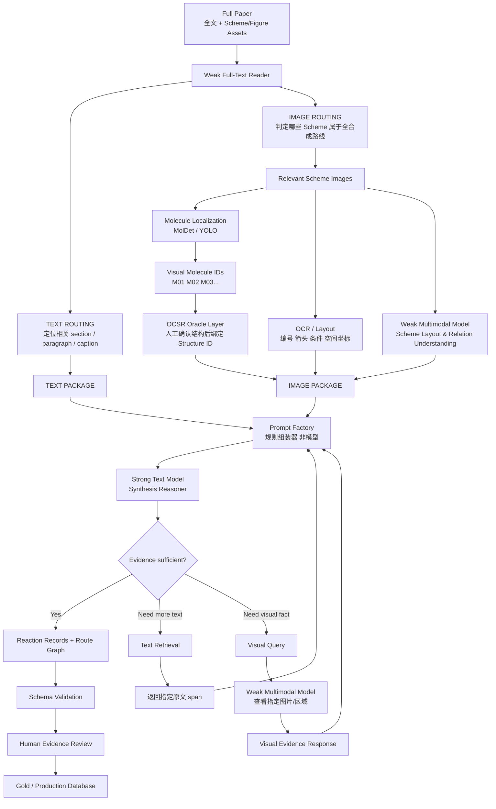
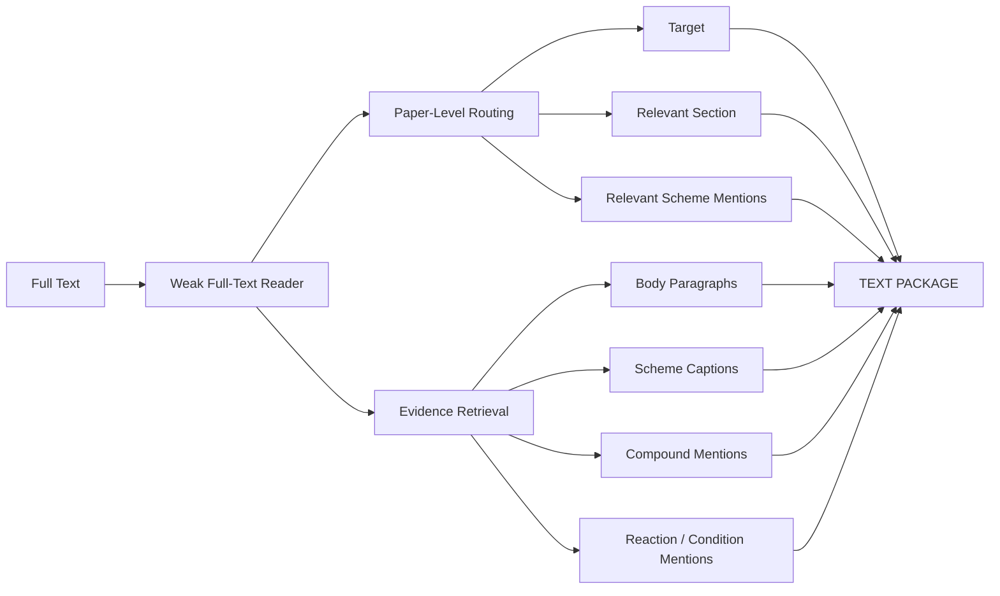
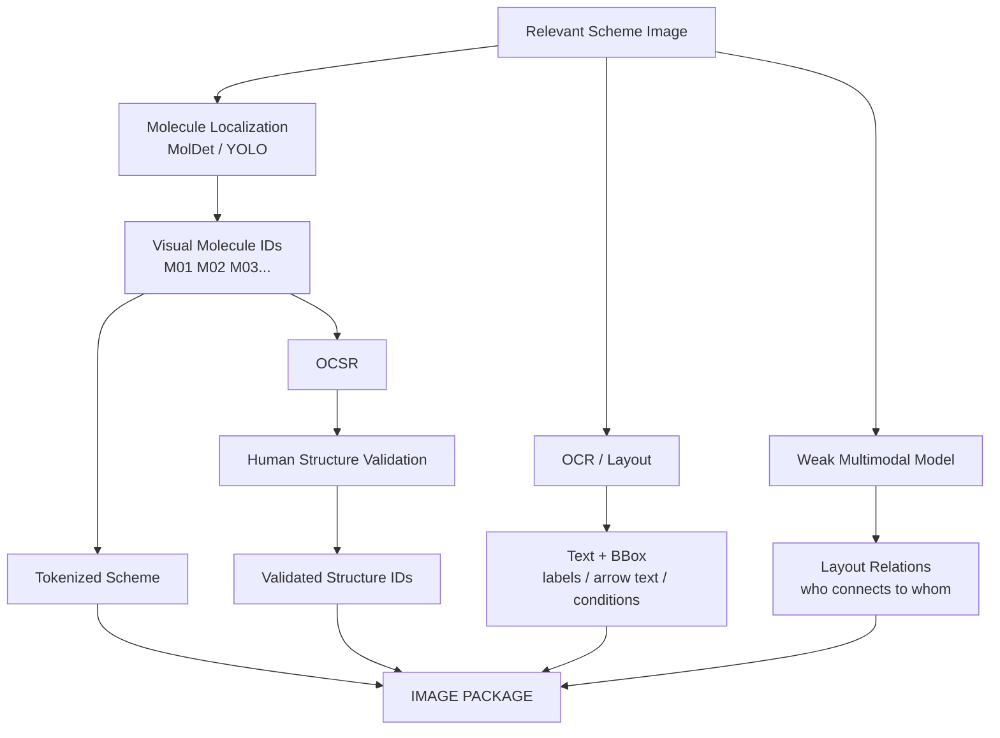
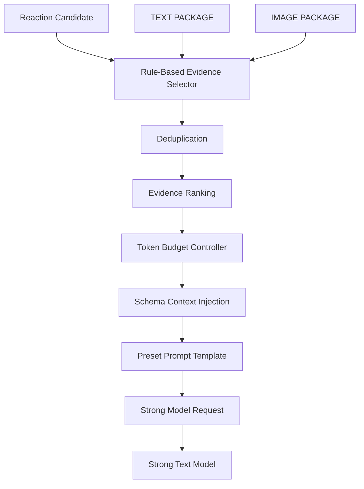
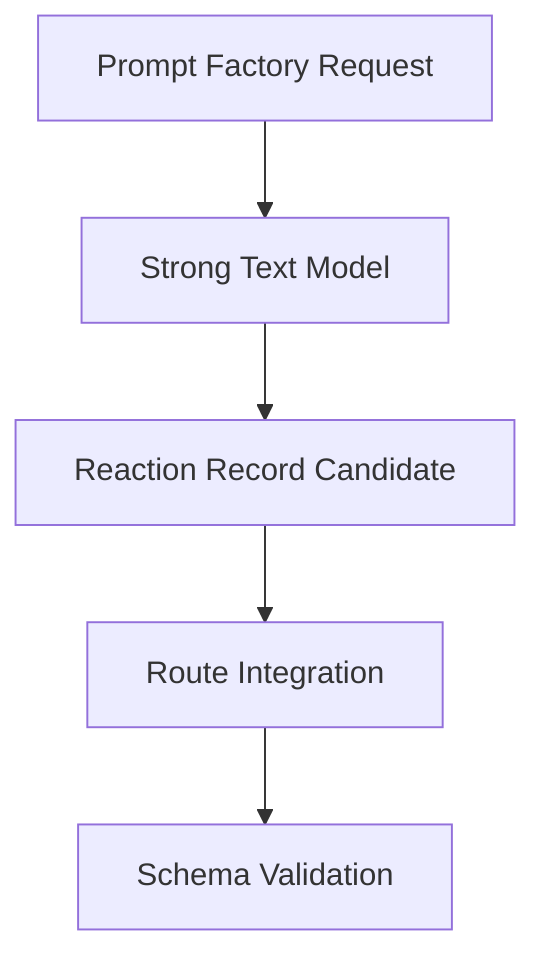
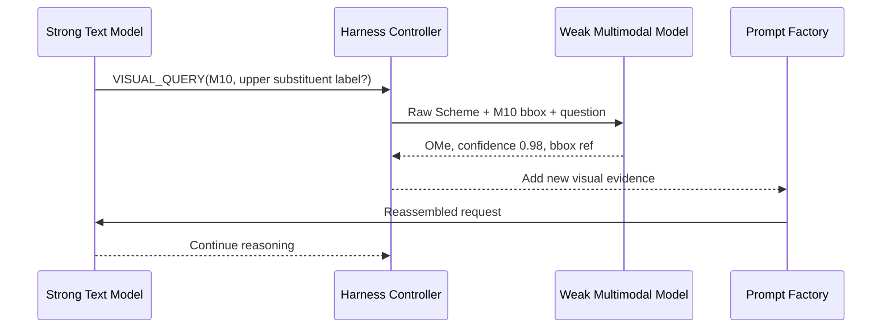
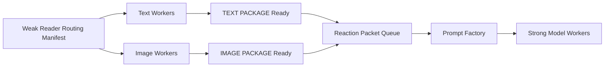
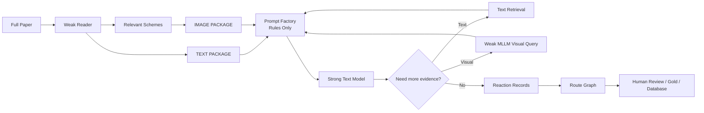

# 全合成文献 Multi-Model 解析 Harness：流程与工程化实现

> **系统目标**  
> 将完整全合成论文自动转换为可审计的 reaction-level 与 route-level 结构化数据。
>
> **关键约束**
> - Strong Model 是**纯文本模型**，不直接看图片。
> - Prompt Factory **不是模型**，而是确定性的规则组装器。
> - Prompt Factory 只负责从 TEXT PACKAGE 与 IMAGE PACKAGE 中选择、排序、裁剪并拼装证据，再附加预设 Prompt 与目标 Schema，交给 Strong Model。
> - Strong Model 如需额外视觉信息，只能发起 Visual Query，由弱多模态模型查看指定图片区域后返回局部事实。
> - 原始论文、原图和原文永久保留，任何模型输出都不能覆盖 source evidence。
> - OCSR 作为独立、经过人工确认的结构层接入，不把 OCSR 本身作为本 Harness 的主要评测对象。

---

# 1. 总体流程



系统核心不是“模型数量多”，而是证据流清晰：

**全文负责发现证据 → 两类 Package 负责缓冲证据 → Prompt Factory 负责规则装配 → Strong Model 负责推理 → Retrieval 负责按需补证据。**

---

# 2. 两类证据 Package

## 2.1 TEXT PACKAGE：全文与强模型之间的证据缓冲层

TEXT PACKAGE 的作用不是总结论文，而是：

> **在不丢失原始事实和 provenance 的前提下，把与某条路线或某个反应相关的原文，从整篇论文中筛选出来。**

Weak Full-Text Reader 只做三件事：

**定位、筛选、索引。**



### TEXT PACKAGE 中建议保存

| 字段 | 作用 |
|---|---|
| Evidence ID | 稳定引用 |
| Raw Text | 原文，不改写 |
| Section / Paragraph / Span | 原文定位 |
| Scheme References | 与哪些 Scheme 相关 |
| Compound Mentions | 出现的编号 |
| Reaction Mentions | 候选反应描述 |
| Condition Mentions | 候选条件、产率、选择性 |
| Relevance Score | 与当前 route / reaction 的相关度 |
| Retrieval Handle | 强模型后续按需回查原文 |

### TEXT PACKAGE 明确不做

- 不生成最终 reaction record；
- 不解决 image/text conflict；
- 不补充未报告条件；
- 不用摘要替代原文；
- 不决定最终 route topology。

可以做轻度标签，但真正传给 Strong Model 的主体仍是**原始文本证据**。

### 两级 TEXT PACKAGE

**Route Text Package**  
包含一整条路线相关的若干段正文，用于整体理解。

**Reaction Text Package**  
只包含某个 Reaction Candidate 最相关的 1–3 个 evidence blocks，用于精确填字段。

---

## 2.2 IMAGE PACKAGE：把 Scheme 转成关系可读的视觉证据



### Visual Molecule ID 是核心接口

每个 molecule region 第一时间获得稳定 ID：

- M01
- M02
- M03

之后所有关系先引用 Molecule ID，而不是直接引用 SMILES。

例如：

- M03 ↔ paper compound 25
- M03 → M04
- M03 ↔ Structure_0025

这样 OCSR 可以独立推进，Route Understanding 不需要等待结构层完成。

### 三种 Scheme View

**Raw Scheme**  
未经修改的原图，用于 evidence、人工审核、Visual Query 和错误追踪。

**Tokenized Scheme**  
把 molecule bbox 替换为统一的 M01 / M02 / M03 Token，但保留 paper label、arrow、condition 和 layout。  
它允许在 OCSR 尚未完成时提前开发 pairing、route understanding 和 Multi-Model Workflow。

**Structure-Normalized Scheme**  
在 OCSR + 人工确认后，把标准化 2D structure 放回原 bbox，并保留 M-ID。用于生产阶段更干净的 Scheme relation understanding。

### IMAGE PACKAGE 最终输出

**Entity Evidence**
- Molecule ID
- bbox
- Structure ID
- paper label candidate

**Relation Evidence**
- M01 → M02
- M02 + M03 → M04
- arrow bbox
- relation confidence

**Arrow / Condition Evidence**
- raw visible text
- OCR text
- condition bbox
- candidate reaction binding

**Visual Interpretation Evidence**
- label ↔ molecule
- arrow ↔ molecule pair
- condition ↔ arrow
- branch / convergence relation

所有结果都保留对 Raw Scheme 的位置引用。

---

# 3. Prompt Factory：纯规则模块，不进行模型推理

> **Prompt Factory 不是 LLM，也不生成摘要。**

它只是一个普通程序模块。

输入：

**TEXT PACKAGE + IMAGE PACKAGE + Preset Prompt Template + Target Schema**

输出：

**Strong Model Request**



### Prompt Factory 只执行这些动作

1. 根据 Reaction ID 找 Image Evidence；
2. 根据 Molecule ID、Scheme、step label 找相关 Text Evidence；
3. 去重；
4. 按固定优先级排序；
5. 控制 token budget；
6. 注入目标 Schema；
7. 注入版本化的固定 Prompt；
8. 发送给 Strong Model。

### Strong Model Request 应包含

**Task Context**
- Paper ID
- Route ID
- Scheme ID
- Reaction Candidate ID

**Image Evidence**
- input/output Molecule IDs
- paper labels
- source step label
- arrow condition raw text
- Structure IDs（结构层已确认时）

**Text Evidence**
- 相关正文原文 span
- caption 原文 span
- 相邻必要上下文

**Target Schema**
- input/output
- operations
- reaction description
- reagents / catalysts / solvents
- temperature / pressure
- yield / ee / dr
- evidence refs
- conflict flags

**Preset Instruction**
- only use provided evidence
- do not infer unreported information
- preserve conflicts
- request more evidence if insufficient

Prompt Factory 的行为必须可版本化、可测试、可复现。

---

# 4. Strong Text Model 与按需 Retrieval Harness

Strong Model 是最终的 **Synthesis Reasoner**。

它负责：

- reaction boundary；
- operation grouping；
- field normalization；
- image/text reconciliation；
- route topology；
- conflict identification；
- final schema output。

它**不能直接看图片**。

---

## 4.1 正常路径



---

## 4.2 两种按需证据请求

### Text Retrieval

Strong Model 可以请求：

- previous paragraph
- next paragraph
- full paragraph
- Scheme caption
- compound mention context
- section context

返回的是**原始文字**，不是另一个模型的总结。

### Visual Query

Strong Model 不能直接看图，因此只发出一个局部视觉问题：

- image reference
- Molecule / Arrow / bbox reference
- narrowly scoped question

由 Weak Multimodal Model 查看指定区域后返回：

- answer
- confidence
- source bbox
- raw visible text（适用时）

---

## 4.3 Visual Query 回路



Visual Query 必须是**局部小问题**，不能变成“重新解析整张 Scheme”。

推荐：
- M07 对应的 paper label 是什么？
- R03 箭头上显示的温度是多少？
- M04 与 M05 是否由同一根箭头连接？
- M10 上画的是 OH 还是 OMe？

### Retrieval Loop 限制

建议：
- 默认最多 2 次 Text Retrieval；
- 默认最多 2 次 Visual Query；
- 仍无法确定 → unresolved；
- source conflict → 保留 conflict，不强制裁决。

---

# 5. 工程化实现

## 5.1 模块边界

| Module | 输入 | 输出 |
|---|---|---|
| Paper Loader | PDF / text / assets | Paper Package |
| Weak Reader | Paper Package | Routing Manifest |
| Molecule Localizer | Scheme Image | Molecule BBoxes |
| OCSR Adapter | Molecule Crops | Structure Candidates |
| Structure Registry | 人工确认结构 | Structure IDs |
| OCR / Layout Adapter | Scheme Image | Text / Layout Evidence |
| Weak MLLM Adapter | image / bbox / question | Visual Evidence |
| Text Package Builder | Full Text + Routing | TEXT PACKAGE |
| Image Package Builder | Visual Modules | IMAGE PACKAGE |
| Prompt Factory | Packages + Schema + Prompt | Strong Model Request |
| Strong Model Adapter | Request | Parsed Record / Tool Request |
| Harness Controller | Current State | Retrieval / Validation / Finalize |
| Review Exporter | Final Candidate | Human Review Record |

---

## 5.2 推荐的数据目录

```text
paper_<paper_id>/
├── source/
│   ├── fulltext
│   ├── figures/
│   └── schemes/
├── routing/
│   └── weak_reader_manifest
├── image/
│   ├── molecule_detections
│   ├── tokenized_schemes
│   ├── normalized_schemes
│   ├── ocr_layout
│   └── visual_evidence
├── text/
│   ├── route_text_packages
│   └── reaction_text_packages
├── structures/
│   └── validated_structure_registry
├── fusion/
│   ├── reaction_packets
│   ├── model_requests
│   └── retrieval_history
├── output/
│   ├── reaction_records
│   └── route_record
└── audit/
    └── provenance_manifest
```

每一阶段都保存中间产物，避免整个 pipeline 只能从头重跑。

---

## 5.3 并行执行



优势：
- Text Branch 不等待 OCSR；
- Image Branch 不等待文本解析；
- OCSR 尚未完成时可先使用 Tokenized Scheme；
- Structure Registry 后续只需给 M-ID 补 Structure ID。

---

## 5.4 缓存与版本

所有中间产物保存版本：

- weak_reader_version
- molecule_localizer_version
- ocsr_version
- ocr_version
- weak_mllm_version
- text_package_version
- image_package_version
- prompt_factory_version
- prompt_template_version
- strong_model_version
- schema_version

如果只修改 Prompt Factory 或 Strong Model Prompt：

> 不需要重新跑 Molecule Detection、OCSR、OCR 和 Weak Reader。

直接用已有 Package replay。

---

## 5.5 Failure Isolation

建议至少区分：

- ROUTING_FAILED
- SCHEME_NOT_FOUND
- MOLECULE_LOCALIZATION_FAILED
- LABEL_BINDING_UNCERTAIN
- OCR_LOW_CONFIDENCE
- VISUAL_RELATION_UNRESOLVED
- TEXT_EVIDENCE_INSUFFICIENT
- STRONG_MODEL_SCHEMA_INVALID
- SOURCE_CONFLICT
- ROUTE_INCOMPLETE

失败任务可以单独 retry，不让单个局部失败拖垮整篇论文。

---

## 5.6 Prompt Factory 的可复现性

每次 Strong Model 调用都保存：

- selected evidence IDs
- evidence ordering
- omitted evidence IDs
- token budget
- prompt template version
- schema version
- strong model version / parameters
- retrieval rounds

这样后续可以直接比较：

> 同一个 TEXT / IMAGE PACKAGE，在不同 Strong Model 或 Prompt Template 下表现如何。

---

# 6. 最终冻结的 Harness 逻辑

整个系统可以压缩成六句话：

1. **Weak Reader 阅读全文，但只负责 routing 和 evidence retrieval。**
2. **TEXT PACKAGE 是保留原文的相关文本缓冲层，不是摘要。**
3. **IMAGE PACKAGE 汇总 Molecule IDs、OCSR oracle、OCR/Layout 和 Weak MLLM 的视觉关系证据。**
4. **Prompt Factory 是确定性的规则组装器，不进行任何模型推理。**
5. **Strong Text Model 只处理整理好的证据，并按 Schema 生成 Reaction / Route 数据。**
6. **证据不足时，Strong Model 只能通过 Text Retrieval 或 Weak-MLLM Visual Query 请求更多原始证据。**



> **整个 Harness 真正稳定的核心不是某个模型，而是 Package、Visual Molecule ID、Schema、Prompt Factory 和 provenance。**  
> OCSR、弱文本模型、弱多模态模型和强文本模型以后都可以替换，而工作流的数据接口与审计逻辑不需要重建。
